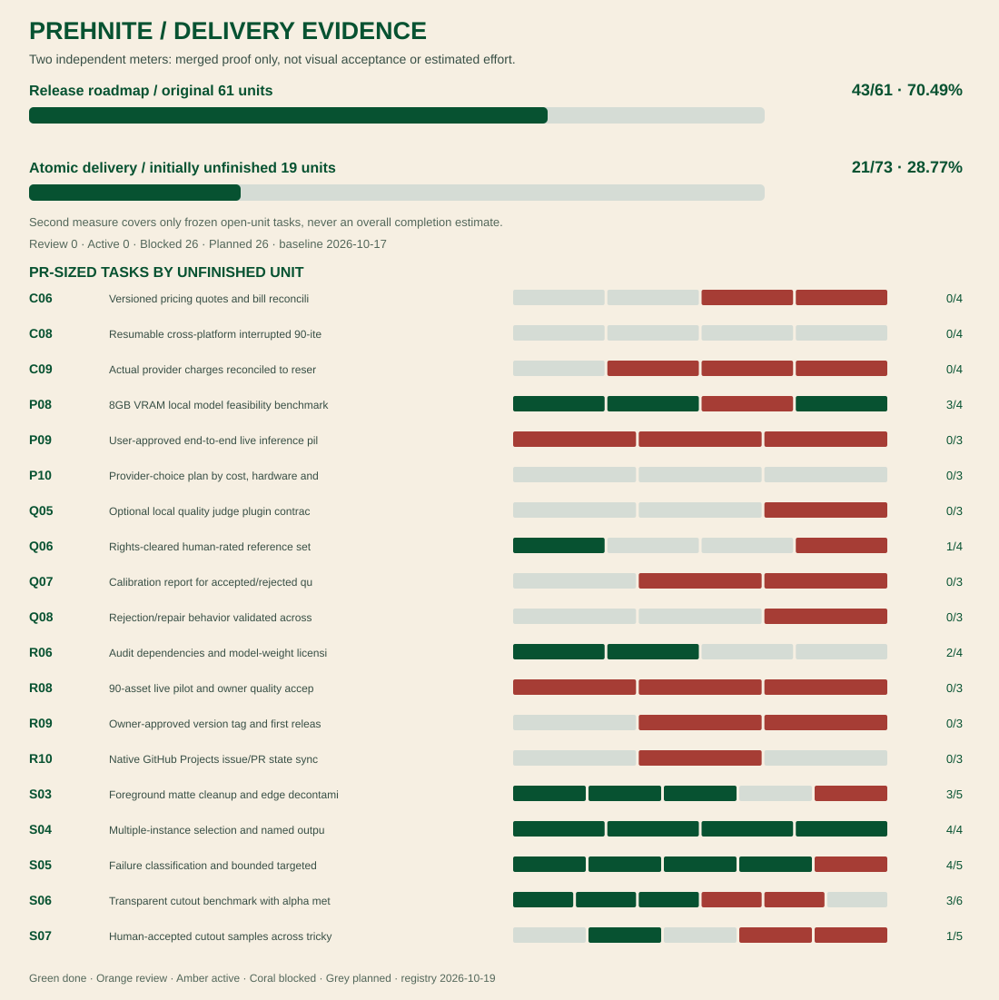

<div align="center">
  
  <p><strong>Batch image production without the platform tax.</strong><br />
  An open-source Python engine for generating, checking, refining and exporting visual assets.</p>
  <p>
    <a href="https://github.com/interzettel/prehnite/actions/workflows/ci.yml"></a>
    <a href="LICENSE"></a>
    
    
    
  </p>
  <p>
    <a href="#try-it-in-two-minutes">Quick start</a> ·
    <a href="#how-it-works">How it works</a> ·
    <a href="#where-things-stand">Project status</a> ·
    <a href="docs/progress/STATUS.md">Progress</a> ·
    <a href="CHANGELOG.md">Changelog</a> ·
    <a href="docs/VERSIONING.md">Versioning</a> ·
    <a href="https://github.com/orgs/interzettel/projects/1">Project board</a>
  </p>
</div>

---

## Ninety images is a different problem from one image

Generating a single good picture is easy to demonstrate. Making a *batch* of assets to a brief, with the correct dimensions, cutouts, filenames, and a predictable bill, is a different job.

Prehnite is an attempt to automate the boring, expensive middle: keeping track of prompts and seeds, trying variants, checking what worked, doing targeted repairs instead of blindly starting over, and handing back exactly the files you asked for.

The ambition is simple: **spend less per *usable* asset, not merely less per generation.** It is a design target, not a claim we've already established with real-world benchmarks.

**Free orchestration is non-negotiable.** Prehnite is MIT licensed, runs locally, and has no required account, hosted workflow subscription, or per-seat platform fee. Use a local model where practical; connect to a paid image API *only when you choose to*, with a budget you set.

## Start with a zero-cost local batch

Run `prehnite init --destination my-first-batch` to get two safe sample
YAML files, then `prehnite doctor` to inspect your Python environment
without revealing any keys or contacting a service. For details, see
[the first-run guide](docs/ONBOARDING.md). These commands do not run AI
image generation or incur any inference costs.

For measured-versus-unknown OS/RAM/GPU inventory, run `prehnite hardware`.
This **offline, read-only** command can query local `nvidia-smi`; it never
certifies a GPU memory tier or recipe feasibility. See
[hardware doctor limitations](docs/HARDWARE_DOCTOR.md) (issue #134).
The **read-only `prehnite resource-preflight`** command is now available in
development `main` via [merged PR #159](https://github.com/interzettel/prehnite/pull/159),
but not in released PyPI `0.1.0a1`. It evaluates explicit operator-set RAM,
commit and VRAM thresholds; passing observations **never authorize inference**.

## Try it in two minutes

You can test the complete workflow without a GPU, credentials, subscription, or inference charge. **The demo creates simple synthetic test images, not AI photographs.**

Clone the repo, create a Python 3.11+ environment, and install:

```bash
git clone https://github.com/interzettel/prehnite.git
cd prehnite
python -m venv .venv
# Windows PowerShell: .\.venv\Scripts\Activate.ps1
# macOS/Linux:        source .venv/bin/activate
python -m pip install -e .
```

Run a preflight estimate, then the zero-cost sample batch:

```bash
prehnite validate examples/manifest.yaml --profile examples/profile-demo.yaml
prehnite estimate examples/manifest.yaml --profile examples/profile-demo.yaml
prehnite run examples/manifest.yaml --profile examples/profile-demo.yaml --workspace workspace
```

Look under `workspace/batches/portrait-pilot/`. You'll find the selected images, the state journal, JSON/CSV reports, an [offline visual gallery](docs/OFFLINE_GALLERY.md) (`gallery.html`), a [local provenance record](docs/PROVENANCE.md) (`provenance.json`), and a ZIP with the requested output paths. A second run reuses completed stages.

<details>
<summary><strong>What the output looks like</strong></summary>

```text
workspace/
└── batches/
    └── portrait-pilot/
        ├── state.sqlite3
        ├── intermediates/
        ├── selected/
        │   └── photos/
        │       ├── street-001.jpg
        │       └── interior-001.jpg
        ├── report.json
        ├── operations.csv
        ├── report.html
        ├── gallery.html
        ├── provenance.json
        └── prehnite-portrait-pilot.zip
```

The ZIP preserves your requested relative filenames. Accepted cutouts, when configured, are transparent PNGs. Internally generated files stay separate from the deliverables.

</details>

## How it works

| | Stage | What Prehnite does |
| :--- | :--- | :--- |
| 01 | **Describe** | Read a structured manifest: prompts or existing images, exact sizes, targets and output filenames |
| 02 | **Plan** | Choose model providers and variants; estimate request counts and spend before starting |
| 03 | **Make** | Run generation and optional upscaling; preserve seeds, inputs and intermediate artifacts |
| 04 | **Check** | Apply technical checks, and optional model-based judgments when configured |
| 05 | **Repair** | Retry selectively under a hard attempt limit; cutout errors needn't regenerate accepted photos |
| 06 | **Deliver** | Export accepted images, named cutouts, a ZIP and an inspectable report |

A small manifest can describe a portrait batch with precise delivery requirements:

```yaml
id: street-pilot
assets:
  - id: rainy-street
    prompt: "A candid smartphone photograph of a rainy street at dusk"
    aspect_ratio: "9:16"
    target_size: [2160, 3840]
    output:
      image: photos/rainy-street.jpg
      cutouts: {}
```

The **manifest** says *what* to make. A separate **profile** says *how*: which provider/model to use, whether to compare 2K-upscaled and 4K variants, what to accept, the retry limit, and whether cloud calls may cost money. See the [working examples](examples/).

### First real local cutout — one independently accepted artifact (2026-10-18)

**First hardware milestone achieved in the private local lab:** An RTX 4070
Laptop GPU produced a real **768×1024** SDXL desk-lamp source, followed by one
successful local **GroundingDINO + SAM2** segmentation submission. The raw
binary mask was refined on CPU; **Candidate A (σ = 0.65 px)** received
independent visual approval at the presented comparison scale. Approved
derivative SHA256: `5e925240e2c527a9922ffad2729fcb9111ed25251f3c2aedfba8c87903bd6450`.

The successful segmentation job completed in **8.994 s** including model loading
and inference, with **2,533 MiB sampled peak VRAM**. It used a short-lived
ComfyUI child process and a private Transformers 4.57.6 compatibility overlay,
without cloud calls, inference retries or changing the existing ComfyUI
environment. The original source generation took ~46.04 s, separately, with
7,763/8,188 MiB sampled peak VRAM; these are **one-off measurements**, not
sustained benchmark or 4K feasibility figures.

The original generation journal's quality rejection, initial failed
segmentation attempt and all historical evidence remain intact. The accepted
candidate has a private local-lab approval record, **not** an owner-signed
Prehnite journal acceptance or a certification of other scenes and materials.
The **public package does not yet ship this combined launcher/refinement
workflow or model weights**. See the [full dated evidence and limitations](docs/LOCAL_LAB_MILESTONE_2026-10-18.md)
and [current delivery matrix](docs/PROGRESS.md).

### Reusable cutout QA and resource observations — merged into development main

**[PR #159](https://github.com/interzettel/prehnite/pull/159) and
[PR #161](https://github.com/interzettel/prehnite/pull/161) are merged into
`main`.** Prehnite now has an opt-in, CPU-only `cutout-qa` and
`cutout-accept` workflow, backed by source/target/workflow/model hashes,
conservative configurable alpha candidates, separate file integrity and
execution-evidence states, topology checks and create-only independent visual
review records. `resource-preflight` provides independent, observation-only
resource evidence. None of these commands starts ComfyUI or automatically
authorizes a GPU job.

The cross-module **pass/blocked/unknown** regression tests from
[closed, unmerged integration PR #162](https://github.com/interzettel/prehnite/pull/162) were preserved in
`tests/test_resource_cutout_integration.py` through #161. GitHub CI for
the combined code passed **25/25 jobs** on #161's updated branch; post-merge
`main` [CI run 39153867726](https://github.com/interzettel/prehnite/actions/runs/39153867726) also passed **25/25 jobs**. This is source code on development
`main`, **not** a new PyPI release or a validated unattended Engine→cutout QA
pipeline. The short-lived local ComfyUI launcher, dependency overlay and model
weights remain private. The new alpha-refinement implementation is not
byte-identical to the originally accepted lamp candidate, and that approval
has not been transferred. See [the dated evidence and scope](docs/LOCAL_LAB_MILESTONE_2026-10-18.md).

### Model Recipe status: micro / macro

Prehnite now has **versioned model-workflow blueprints** rather than a single hard-coded model. `prehnite-micro` targets operator-configured, local-first ComfyUI runs; `prehnite-macro` explores later high-capability/hybrid workflows. The checked-in JSON recipes **do not contain models or execute on their own**.

| Capability | `prehnite-micro` | `prehnite-macro` |
| --- | --- | --- |
| Versioned manifest / capability graph | Implemented | Implemented |
| Local model/input hash resolver | Implemented, operator-supplied | Not implemented |
| Recipe-bound engine/journal execution path | Experimental, opt-in | Not implemented |
| Checkpoint installer and rights review | Planned | Planned |
| Real GPU & human-cutout-quality benchmark | **One local lamp cutout visually accepted; general benchmark open** | Unverified |

**Read the [recipe roadmap](docs/ROADMAP.md#model-recipes-workstream--versioned-micromacro-october-2026) and [recipe architecture](docs/MODEL_RECIPES.md)** for completed code, the single local-lab cutout demonstration and the still-open release gates. Neither mode claims a certified 4/6/8/12 GB laptop tier or preinstalled models.

### Multi-file local model identity (static, not runtime certification)

The new [schema-v2 model bindings](docs/MULTIFILE_PROVENANCE.md) hash every explicitly declared graph-loaded transformer/text-encoder/VAE/auxiliary weight file under the operator-controlled model root, and refuse undeclared file-style model references or changed bytes on resume. Legacy single-file receipts remain compatible. File-level SHA256 **cannot establish** which weights ComfyUI actually loaded in memory or whether model licenses permit use.

### True 1K laptop micro preview (no fake 4K resize)

A separate [native-1K local preview](docs/FIRST_REAL_ASSET.md#8-gb-laptop-smoke-test--genuine-native-1k) now requests **768×1024** pixels at 3:4 for one small smoke test. It refuses to upscale undersized model output silently and does not change the legacy native-4K preview or any hosted pricing and schemas. One later owner-authorized native-1K SDXL lamp generation and an independent local
cutout have now been demonstrated; the original **preview recipe's general hardware
compatibility, quality thresholds and third-party licensing** remain unverified.

### Implicit segmentation model-file attestation (opt-in)

Reviewed-source cutout batches can now pin a [private dependency manifest](docs/IMPLICIT_DEPENDENCIES.md) for GroundingDINO/SAM2/BERT model weights, tokenizer/config files and declared custom-node source files. SHA256 is rechecked before local execution and resume; this does **not** prove custom-node runtime loads, permissions or model quality. Existing reviewed-source packets remain compatible and never silently acquire a "verified" claim.

### Human-reviewed source → new cutout batch (opt-in, local only)

The [reviewed-source handoff](docs/REVIEWED_SOURCE_HANDOFF.md) hashes the original generated PNG, its human review and an explicit structured attestation before opening a **new source-only batch**. Segmentation produces a `review_pending/` candidate and never converts the original rejected generation batch to accepted, runs generation again, changes `uncertain: reject`, or claims the cutout passed human review. Requires separately installed/licensed local segmentation graphs/weights; this development feature is not in PyPI `0.1.0a1`.

### First real model test — local or opt-in fal.ai

The development CLI offers **`prehnite trial-evidence`** to produce a private, hash-bound technical receipt for a real generated image and transparent cutout without uploading or mutating either image. A valid image receipt is not proof of a human-accepted mask or measured GPU performance.\n\nThe development CLI offers **`prehnite micro-setup`** for create-only, hash-verified local graph/weight bindings and **`prehnite trial-plan`** for a one-asset, zero-provider-call dry-run with explicit cost caps before any local ComfyUI or fal.ai inference. The [operator runbook](docs/FIRST_REAL_ASSET.md) includes platform setup, graph mapping, source-rights checks, error/evidence collection and carefully gated first API testing. These are **development changes**, not present in the already published immutable `0.1.0a1` wheel; use a current source checkout until a subsequent alpha is approved. No pretrained weights or live GPU/paid-provider results are supplied.

### Explicit local ComfyUI recipe execution (experimental)

The existing `prehnite run` command can now pin an operator-supplied micro recipe
and exact local workflow/checkpoint SHA256 to a batch's SQLite journal using
`--recipe --bindings --workflows --checkpoints`. Model/graph mismatches and
unbound resumes fail closed; **actual ComfyUI execution requires the operator's
separate local ComfyUI process, checkpoints and compatible graphs** and has not
been GPU-benchmarked. See [recipe execution limitations](docs/RECIPE_EXECUTION.md).

### Local micro recipe input verification (non-executable)

`prehnite recipe-resolve` verifies explicitly supplied local ComfyUI API graphs and
checkpoint bytes against SHA256 and operator-acknowledged terms without downloads,
cloud calls, credentials or inferred GPU suitability. This **inspection command**
produces a read-only, non-executable receipt; use the separate, opt-in
`prehnite run` recipe bridge above to bind those inputs to a real batch.
See the [operator setup and limitations](docs/LOCAL_MODEL_RESOLVER.md).

### Bring your own models, not your own orchestration subscription

| Route | What it means today |
| --- | --- |
| **Demo (no-cost)** | Synthetic generator + Pillow resize and technical checks. Runs offline and is covered by CI. |
| **Local ComfyUI** | Operator-supplied ComfyUI workflows and model weights on localhost. One pinned SDXL → GroundingDINO/SAM2 lamp case was run locally and its refined derivative independently accepted; **that private setup is not yet bundled or validated as a general-purpose installable workflow**. |
| **fal.ai (optional paid)** | Opt-in hosted image generation/upscaling/segmentation adapter. Interfaces exist, but real endpoint schemas, pricing and image results still require live integration tests. |
| **Anthropic judge (optional paid)** | An opt-in image comparison/rubric adapter. It is not a calibrated or production-validated quality benchmark. |

No paid stage can be enabled by simply running the demo. Real cloud profiles require explicit `allow_paid` and, where images leave your machine, `allow_cloud_uploads`. They also require per-stage cost estimates and a positive `max_usd` cap. **Reserved amounts are estimates, not provider invoices or guaranteed billing ceilings.**

You can inspect what each adapter is actually prepared to run using
`prehnite models`. The [typed capability catalogue](docs/PROVIDER_CONTRACTS.md)
lists operation/input types, supported tiers and formats, upload requirements,
schema references, licensing cautions, and unimplemented candidates. Preflight
checks unsupported paid models and incompatible options **before an API call**;
custom ComfyUI graphs remain user-defined. The catalogue never supplies a
live price: all paid quotes in example profiles must be verified and updated
by you.

For the locally hosted route, start with [the ComfyUI example profile](examples/profile-comfyui.yaml). For pay-per-use hosting, review [the fal profile](examples/profile-fal.yaml), verify endpoint contracts and current prices, and provide your own `FAL_KEY`. Do not use the sample prices as a quote.

### Inspect detail without paying a judge

Image previews can hide important 4K defects. You can create **native-pixel detail crops** and an annotated overview entirely offline:

```bash
prehnite crops my-photo.png --output detail-evidence --edge 1024
```

The output includes five lossless corner/center crops and a SHA256 manifest. Add `--anchor-x 0.45 --anchor-y 0.35` for one manually chosen area. This creates review evidence, **not an automated quality score**. [Read the crop guide](docs/CROP_EVIDENCE.md).

### Opt-in reuse for repeatable stages

Prehnite can keep locally verified stage outputs in a
[private, content-addressed cache](docs/CACHING.md). It is disabled unless
you specify an explicit owner namespace; prompts, seeds, input hashes,
model options, version and model revision participate in the cache key.
Cloud-model reuse requires a separate cache opt-in and a pinned model
revision. A cache hit has no *new* provider request, but it does not erase
historical charges or prove previously billed amounts.

### Measure cost per usable asset, not raw generations

The offline [economics report](docs/ECONOMICS.md) distinguishes
**reserved/estimated spend** from **provider-reported partial amounts** and
**verified invoices** (currently unavailable). It tracks accepted versus
rejected assets, repeated stage invocations, local timing coverage and
cost-per-accepted output. Failures still contribute to reserved cost; a
batch with zero accepted assets has no meaningful cost-per-accepted figure.

## Where things stand

**Latest public release: `0.1.0a1` — [published on PyPI](https://pypi.org/project/prehnite/0.1.0a1/) and [tagged on GitHub](https://github.com/interzettel/prehnite/releases/tag/v0.1.0a1) on 2026-10-17.** Current source development version: **`0.1.0a2.dev0` (unpublished)**. Install the released alpha with `python -m pip install prehnite==0.1.0a1`. See [Changelog](CHANGELOG.md), [Versioning](docs/VERSIONING.md) and [Release policy](docs/RELEASING.md). The core synthetic workflow works and **one native-1K local lamp cutout has independent artifact-level visual approval**; photorealistic quality across categories, 4K GPU feasibility, general segmentation accuracy and actual API billing have **not** been certified.

**Evidence status (2026-10-18):** the private lab achieved one accepted
real cutout; the optional source-code QA implementation and resource observations
are now **merged into development `main`**, not yet independently
live-validated on another object or released as a new PyPI version. See
[the dated milestone](docs/LOCAL_LAB_MILESTONE_2026-10-18.md).
This **does not silently convert** a frozen milestone parent, hardware tier,
cross-category quality corpus or owner-signed journal gate to complete.
The original release ledger remains **42/61 (68.9%)**. The original frozen atomic register is now **18/73 (24.66%)**: [S03-A03](https://github.com/interzettel/prehnite/pull/164) proved bounded color-spill correction, [S04-A02](https://github.com/interzettel/prehnite/pull/167) established deterministic instance identities, and [P08-A01](https://github.com/interzettel/prehnite/pull/166) supplied a reproducible local GPU environment and model-weight licence record after independent review. P08's hardware benchmark parent remains blocked. S04-A02 defines deterministic intended outputs; the separately merged [S04-A03](https://github.com/interzettel/prehnite/pull/171) binds a uniquely owner-selected existing mask to an instance without modifying other masks. Neither task exports the multi-object cutouts yet (S04-A04 remains open). Other atomic tasks and parent release gates remain open until their distinct criteria are met. See the [unchanged 73-task baseline](docs/progress/ATOMIC.md) and [two-day reconciliation](docs/progress/RETROSPECTIVE_2026-10-18.md). The merged #159/#161 changes are development
source only; they are not included in the published `0.1.0a1` package.

The tracker distinguishes implemented scaffolding from independently evidenced completions, and records issues blocked by broader hardware validation, human calibration or paid-call authorization.

[](docs/progress/ATOMIC.md)

**Two different measures:** The original 61-unit release roadmap counts complete, evidenced units. The [atomic task tracker](docs/progress/ATOMIC.md) counts smaller PR-sized deliverables **only within the initially unfinished roadmap units**. An atomic task may finish without completing its parent; neither percentage measures image quality or engineering hours. [Full original milestone chart](docs/progress/progress.svg).

[Read the 61-unit release ledger](docs/progress/STATUS.md) · [73 agent-sized tasks and acceptance criteria](docs/progress/ATOMIC.md) · [90-asset no-cost benchmark](docs/OFFLINE_90_BENCHMARK.md) · [Technical release gates](docs/PROGRESS.md) · [Offline production analytics](docs/OFFLINE_ANALYTICS.md) · [Private native source/output inspection](docs/NATIVE_INSPECTION.md) · [Pixel-grid diagnostics](docs/PIXEL_DIAGNOSTICS.md) · [Affine v2 registration contract](docs/AFFINE_CONTRACT.md) · [Experimental Jev typed visual judge](docs/JEV_VISUAL_JUDGE.md) · [Unified decision engine](docs/DECISION_ENGINE.md) · [Attested 4K tile diagnostics](docs/ALIGNMENT_TILES.md) · [Optional Parquet export](docs/PARQUET_EXPORT.md) · [1:1 native image inspection](docs/NATIVE_INSPECTION.md) · [Failure codes and recovery actions](docs/FAILURE_TAXONOMY.md) · [Current sprint](docs/SPRINT.md) · [Roadmap](docs/ROADMAP.md)

The [Produce / Explore / Experiment evaluation RFC](docs/BATCH_OBJECTIVES.md) describes future batch modes and a measurement framework; v0.1 implements neither a general exploration planner nor a Pareto dashboard.

GitHub [Project #1](https://github.com/orgs/interzettel/projects/1) tracks workflow; the version-controlled [ledger](progress/ledger.json) tracks evidence. They answer different questions. Native Project field syncing is still [planned](https://github.com/interzettel/prehnite/issues/44).

## Built for a maintainer and their agents

Prehnite has a CLI first, optional [stdio MCP tools](src/prehnite/mcp_server.py) second. A person can run it directly; agents can submit preconfigured batches, check status, and request exports without being given arbitrary shell access. MCP workers now support [durable reconnect and cooperative pause/cancel/resume](docs/MCP_LIFECYCLE.md) on the main branch; a stop request does not immediately stop an in-flight provider request.

The project itself is managed the same way: small issue scopes, PR-based delivery, offline tests, and a persistent [agent-to-agent handoff thread](https://github.com/interzettel/prehnite/issues/9). One maintainer sets direction and approves spend and releases. Agents do the repeatable engineering work and leave evidence—not inflated status reports.

To contribute or extend the engine, start with [Contributing](CONTRIBUTING.md), [Architecture](docs/ARCHITECTURE.md), [Security](docs/SECURITY.md), and [Versioning](docs/VERSIONING.md). Issues are welcome, particularly for adapters that remain optional and testable without network access.

## License and boundaries

**[MIT](LICENSE)** for Prehnite's own code. Image models, checkpoints, external APIs, datasets, and other installed applications retain **their own** terms; nothing about this repository grants a license to third-party weights. See [Licensing](docs/LICENSING.md) and the [release policy](docs/RELEASING.md).

No model checkpoint ships with the repo. No mandatory hosted product or subscription. Further release tags and uploads require separate owner approval and verified gates.
