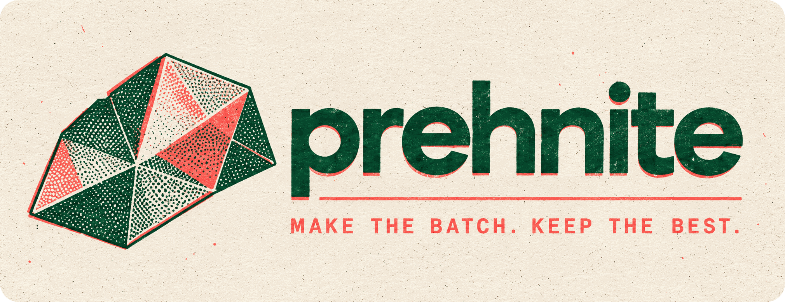
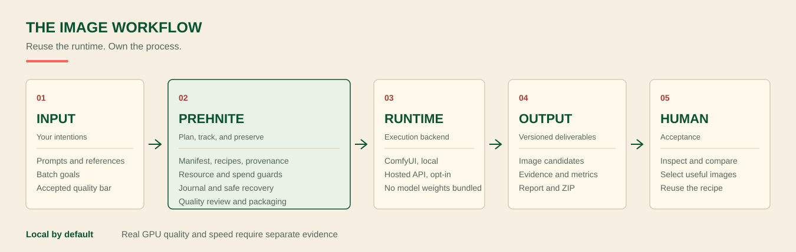
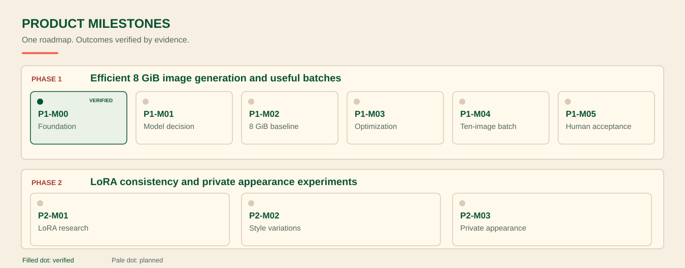

<div align="center">



### Make the images. Keep the experiments.

**A local-first image workbench for reproducible generation, batches, quality checks and creative experiments.**

Built with an 8 GiB laptop GPU in mind. Use your own ComfyUI workflows, or choose an explicitly configured API.

[](https://github.com/interzettel/prehnite/actions/workflows/ci.yml)
[](LICENSE)
[](pyproject.toml)

[Get started](#get-started) · [Image backends](#image-backends) · [Current capabilities](#what-works-today) · [Progress](#development-progress) · [Contribute](#explore-and-contribute)

</div>

## A workbench, not another inference engine

Prehnite helps you set up an image job once, run it with an existing image backend, and keep track of what actually happened. Manifests and recipes describe the requested assets; resource and budget policies limit what can run; a persistent journal handles interrupted batches; reports and exports preserve results and their provenance.

The goal is to make local image generation practical and portable, without recreating ComfyUI's graph editor or bundling somebody else's model weights. You can start with a zero-cost demo, connect your own local workflows, or explicitly opt into supported API calls.



## What works today

| Capability | Available today | Important distinction |
| --- | --- | --- |
| **Batch production** | Validated manifests, variants, jobs, SQLite journal, restart/recovery safeguards and stage cache | The synthetic path is fully exercised; a real ten-image local acceptance batch is still pending |
| **Local generation** | ComfyUI API graph adapter, checkpoint/recipe bindings, resource observations and preflight | One private 768 × 1024 SDXL result has been observed on an RTX 4070 laptop; no broad speed or quality guarantee |
| **Hosted inference** | fal.ai queue adapter with generation, upscale and segmentation contracts | Actual paid runs, prices and invoices are not certified by offline contract tests |
| **Image inspection** | Technical dimension/format checks, configurable judge contracts, static gallery, provenance and report exports | Technical checks alone cannot judge whether an image looks good |
| **Cutouts** | SAM-compatible segmentation contracts, named multi-object exports, alpha QA and experimental soft-matte preservation | Difficult hair, mesh and glass acceptance remains to be demonstrated |
| **Delivery and automation** | CLI and MCP entry points, deterministic ZIPs, JSON/CSV/HTML reports, receipts and cost estimates | An estimated provider price is not an actual bill |

Prehnite has existing code, tests and integrations behind these capabilities. It is not just a plan. The next work focuses on connecting them into a convenient, *measured* real-image experience.

## Get started

Python **3.11+** is required. This quick start generates synthetic demonstration images offline, without a GPU, model download or paid provider.

```bash
git clone https://github.com/interzettel/prehnite.git
cd prehnite
python -m venv .venv
```

Activate the environment:

<details>
<summary>Windows PowerShell</summary>

```powershell
.\.venv\Scripts\Activate.ps1
python -m pip install -e .
```

</details>

<details>
<summary>Linux or macOS</summary>

```bash
source .venv/bin/activate
python -m pip install -e .
```

</details>

Then run:

```bash
prehnite
prehnite init --destination my-first-batch --batch-id sample-one
prehnite doctor
prehnite validate my-first-batch/manifest.yaml --profile my-first-batch/profile.yaml
prehnite estimate my-first-batch/manifest.yaml --profile my-first-batch/profile.yaml
prehnite run my-first-batch/manifest.yaml --profile my-first-batch/profile.yaml --workspace workspace
```

Running bare `prehnite` displays the terminal wordmark. Automated subcommands keep normal machine-readable output. The demo uses synthetic images, not AI-generated photographs, so it can validate the batch workflow without an external model.

You can also inspect [the first-run guide](docs/ONBOARDING.md), [sample profiles](examples/) and [the offline gallery](docs/OFFLINE_GALLERY.md).

## Image backends

The provider choice is explicit. Prehnite does **not** silently route personal source images to a cloud provider or choose a billable fallback when local inference is unavailable.

| Backend | Implemented integration | Configuration and current limits |
| --- | --- | --- |
| **ComfyUI** | Local queue/history adapter for API-format generation, upscaling and segmentation workflows | Supply your own running ComfyUI, API graphs, checkpoints, mappings and licenses. Local hardware compatibility is model-specific. |
| **fal.ai** | Queued FLUX.3 Klein and FLUX.3 Image generation, ESRGAN upscaling, and SAM 3.1 segmentation | Optional `prehnite[fal]`, `FAL_KEY`, exact supported model IDs, budget and upload authorization. Offline contract coverage does not imply verified live pricing or availability. |
| **Demo / Pillow** | Offline synthetic image, simple mask and interpolation adapters | Suitable for trying the engine and regression testing, not for judging photographic generation quality. |
| **Anthropic** | Optional separate image-quality judge integration using a configured model | A judging capability, **not** a text-to-image backend. Requires separate API configuration and permission for image submission. |

Other providers and runtimes, including Higgsfield, are **research candidates**, not silently supported adapters. For exact implemented model contracts see [the registry](src/prehnite/registry.py) and [provider adapters](src/prehnite/providers.py).

To inspect your GPU and available memory without starting a model:

```bash
prehnite hardware
prehnite doctor --check-comfyui --comfyui-url http://127.0.0.1:8188
```

The second command checks a local ComfyUI server at the specified loopback address. It does not load a checkpoint. For a real example with explicit model and workflow binding, use the [local 1K guide](docs/FIRST_REAL_ASSET.md) and [recipe execution guide](docs/RECIPE_EXECUTION.md).

**One measured local observation:** an RTX 4070 laptop produced a 768 × 1024 SDXL image in approximately 46 seconds during an earlier controlled session. That demonstrates an individual run, not a repeatable model benchmark or an optimization win. [Technical record](docs/LOCAL_LAB_MILESTONE_2026-10-18.md).

## Development progress

**Engineering evidence: 43/63 tasks verified (68.3%). Outcome acceptance: 1/9 milestones (11.1%).**

Both numbers come from the **same** [canonical roadmap](progress/roadmap.json). The first counts independently evidenced implementation and new task work; the second requires full research, real-machine and user-acceptance gates. Neither is a claim that 68% of all possible images are production-ready.



| Priority | Workstream | Supporting work evidenced | Missing outcome |
| --- | --- | ---: | --- |
| **P0** | Model and provider selection | 4/6 (66.7%) | Decide on one pinned, lawful model and an apples-to-apples benchmark |
| **P1** | Local 8 GiB inference evidence | 3/5 (60.0%) | Perform an authorized repeatability experiment and independent review |
| **P1** | Batch and recovery | 18/21 (85.7%) | Complete a real ten-image batch, selection, recovery and export pilot |
| **P2** | Memory and throughput | 0/3 (0.0%) | Measure an optimization against the unchanged runtime baseline |
| **P2** | Quality and delivery | 7/9 (77.8%) | Review real images and accepted-image yield |
| **P3** | LoRA and appearance experiments | 0/8 (0.0%) | Research and implement consistent style/reference workflows |

The already accepted foundation and project tooling account for another **11/11 verified tasks**. Phase 1 is about making generation and useful batches reliable on an existing 8 GiB laptop. Phase 2 adds controlled LoRA experiments, consistent styling, and private reference-based appearance changes.

See the [full priority-ordered progress report](docs/progress/STATUS.md) for every task, source PR, dependency, blocker and completion criterion.

## Design principles

**Local first, APIs by choice.** Real work can remain on your machine; hosted use must be deliberately enabled. The ability to call fal.ai is a feature, not a compulsory subscription.

**Use existing runtimes.** Prehnite orchestrates generation, memory checks, evidence, selection and delivery. It doesn't replace ComfyUI or train its own diffusion foundation models.

**Measure before claiming faster or better.** Offloading can save VRAM but consume system RAM or latency. Quality is judged against a real brief, not solely by technical test passes.

**Keep the details.** Model IDs, seeds, prompts, adapter settings, checksums, retries and outputs should be reproducible and auditable.

## Explore and contribute

[CLI and onboarding](docs/ONBOARDING.md) · [Architecture](docs/ARCHITECTURE.md) · [Image recipes](docs/MODEL_RECIPES.md) · [Roadmap](docs/PRODUCT_MILESTONES.md) · [Contributing](CONTRIBUTING.md) · [Issues](https://github.com/interzettel/prehnite/issues)

Prehnite's source code is distributed under the [MIT License](LICENSE). ComfyUI, model checkpoints, LoRAs, third-party nodes and hosted models are governed by their own terms. Model weights are not bundled. Review the [licensing guide](docs/LICENSING.md) before connecting third-party models.

<div align="center"><sub>Prehnite. Make images, keep the experiments.</sub></div>
