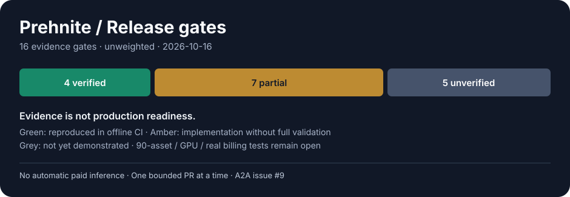

# Prehnite — delivery readiness and work limits

See also the [granular milestone tracker](progress/STATUS.md), generated from 61 independently verifiable work units. This 16-gate matrix is deliberately separate: passing small tasks does not prove release readiness.

**Baseline:** 2026-10-16 · **Local evidence update:** 2026-10-18 ([first accepted lamp cutout](LOCAL_LAB_MILESTONE_2026-10-18.md)) · Source of truth: GitHub [issues](https://github.com/interzettel/prehnite/issues), [PRs](https://github.com/interzettel/prehnite/pulls), [CI](https://github.com/interzettel/prehnite/actions), and [A2A log #9](https://github.com/interzettel/prehnite/issues/9).

## Reading this chart

There are **16 release gates**, each counted once. **4 have reproducible evidence, 7 have partial implementation, and 5 are unverified.** These are **not equally sized tasks**, so 4/16 is **not** a claim that 25% of engineering work or model quality is complete. In particular, green unit tests on a synthetic demo do *not* prove real image generation, visual correctness or production suitability.

| Gate | Scope | Evidence level | What is actually known / remaining |
|---|---|---|---|
| G01 | MIT package and install/CI | Verified | Public MIT license, Python wheel contract, GitHub Actions passed |
| G02 | Manifest/output security checks | Verified | Path traversal, collisions, ratio and size unit tests |
| G03 | Zero-cost synthetic batch | Verified | Offline two-asset demo end-to-end and repeat-run tests |
| G04 | ZIP/report integrity | Verified | ZIP filenames, CRC and reports tested on demo |
| G05 | Provider-independent hosted APIs | Partial | fal adapter written; current endpoint input/output contracts not smoke-tested |
| G06 | Local ComfyUI support | Partial | Loopback API and recipe-to-engine bridge have synthetic tests; **one owner-authorized local 768×1024 SDXL generation and one real GroundingDINO/SAM2 cutout were observed**, with live graph registration and sampled VRAM. Private launcher/overlay is not packaged; cross-machine and repeatable product workflow remain unverified ([local evidence](LOCAL_LAB_MILESTONE_2026-10-18.md)) |
| G07 | Model-based image judge | Partial | Haiku rubric implementation; no API validation, image quality calibration or crop checks |
| G08 | Object cutouts and refinement | Partial | **One real lamp segmentation plus CPU alpha-refined Candidate A independently visually accepted** at a specific comparison scale; no gold/reference-mask calibration, fine materials, multi-object benchmark or public reusable refinement pipeline ([local evidence](LOCAL_LAB_MILESTONE_2026-10-18.md)) |
| G09 | Durable restart and remote-id recovery | Partial | Mocked replay/uncertain-call tests, exclusive lock and atomic recipe/config identity refusal on resume; real crash injection pending |
| G10 | Estimated spending limits | Partial | Offline reserved-cost tests and preflight prices; live rates/invoices not verified |
| G11 | MCP worker and exports | Partial | stdio entrypoint and subprocess implemented; live agent disconnect/cancel not verified |
| G12 | Evaluator calibration and high-res QA | Unverified | Need local judges, test assets and crop/edge evaluation |
| G13 | Real provider billing reconciliation | Unverified | Need documented billing integration and paid pilot |
| G14 | 10-asset credentialed integration pilot | Unverified | Requires separately authorized paid calls |
| G15 | 90-asset mixed-format production pilot | Unverified | Requires quality, cost and restart evidence |
| G16 | Windows GPU, security and operations | Unverified | **One Windows RTX 4070 Laptop run supplied RAM/commit/VRAM and launcher-recovery evidence**, but full hardware-tier/cross-platform operations, reproducibility, threat model, third-party rights and release security remain open ([local evidence](LOCAL_LAB_MILESTONE_2026-10-18.md)) |

**Critical path:** #5 recovery/billing → #7 provider conformance pilot → #3 segmentation/matting → #4 typed quality judges → #2 local workflows → #6 analytics → #8 Windows/MCP lifecycle. Other safe tasks can proceed concurrently only if separate agents coordinate via #9.

## Limits of work: binding constraints

| Limit | Operational rule |
|---|---|
| API spend | **$0 unless user explicitly authorizes that particular paid experiment**. No automatic cloud inference, image uploads or judge tokens |
| SaaS / platform fees | **$0**. MIT Python core and optional separately installed open-source tools only |
| Run scope | One bounded, reviewable change per interactive/scheduled execution; no promise of continuous unsupervised work |
| PRs | No unchecked writes to \`main\`; open feature branches, require CI/review, no future auto-merges without approval |
| Cost certainty | Reserves are configured estimates, *not* billing guarantees. Without live provider prices, refuse missing estimates; ambiguous submissions fail closed |
| Retry caps | Per asset, at most configured \`maximum_attempts\` (1–10); no endless judge/generation loop |
| Concurrency | One active batch worker per batch ID via OS-level file lock; different batch IDs can run separately |
| Outputs | Strict archive-relative filenames; source under allowlisted input root; only accepted assets enter delivery ZIP |
| GPU | No promise of 4K local viability on an 8GB GPU until actual VRAM/performance tests |
| Quality | Technical checks ≠ perceptual accuracy. With visual judge absent, acceptance needs explicit \`accept_unverified\` policy |
| Session continuity | GitHub issue #9 and this document are durable memory; no assumption another session inherits scratchpad/context |
| Dependency licenses | No bundled model weights; independently evaluate checkpoints and dependency licenses before release |

## Local case-study progress outside frozen release percentages

**2026-10-18 — one of one completed local desk-lamp cutout candidates independently visually accepted.**
The first submission failed on a Transformers/BERT API mismatch; a separately
authorized private compatibility overlay and supervised ComfyUI process then
produced one successful GroundingDINO/SAM2 binary mask. A conservative,
CPU-only alpha refinement preserved the silhouette and was independently
visually approved for this artifact. The laboratory's acceptance record is
**not an owner-signed Prehnite journal decision**. [Evidence, hashes, times,
memory and constraints](LOCAL_LAB_MILESTONE_2026-10-18.md).

**Follow-up code progress (reported 2026-10-18):** Productization
Sprint 1 prepared a source branch now submitted as **[draft PR #161](https://github.com/interzettel/prehnite/pull/161)**
(commit `f4c86da`), with additive `cutout-qa` and `cutout-accept` commands,
configurable CPU alpha candidates and separate evidence states; the consolidated
runtime entry point remains private. Closeout ran **14 new CPU tests**;
host full suite reported **865 passed, 15 skipped, 1 Windows symlink-privilege
failure**; GitHub Actions [run 39150686394](https://github.com/interzettel/prehnite/actions/runs/39150686394)
finished with **25/25 passing jobs**. No new GPU inference occurred. The
draft remains unmerged pending independent evidence-contract and runbook fixes.
The public package, automatic Engine QA integration and next-object acceptance
remain open. See [dated evidence](LOCAL_LAB_MILESTONE_2026-10-18.md#subsequent-productization-sprint-same-date-private-branch-not-yet-public)
and draft documentation [PR #160](https://github.com/interzettel/prehnite/pull/160).

**Counting impact: none yet.** The generated 61-unit release tracker remains
**42/61 (68.9%)**, its seven milestone gates remain **2/7**, and the atomic
unfinished-work register remains **14/73 (19.18%)**. For example, P08 still
requires repeatable 8 GiB recipe feasibility evidence, and S06/S07 still
require diverse, independently reviewed real masks. This is **new verified
case-study progress**, not proof those broader contracts have passed.
The 16 technical release gates remain **4 verified / 7 partial / 5 unverified**;
G06 and G08 descriptions have been updated, not promoted. Draft [PR #159](https://github.com/interzettel/prehnite/pull/159)
adds observation-only resource policy but is not merged. Productization of the
private launcher/refinement and measured diverse-object tests are next.

## Work log / milestones

- **2026-10-17:** Recipe architecture contracts and local bridge landed in [#138](https://github.com/interzettel/prehnite/pull/138), [#139](https://github.com/interzettel/prehnite/pull/139), [#140](https://github.com/interzettel/prehnite/pull/140), [#141](https://github.com/interzettel/prehnite/pull/141) and [#142](https://github.com/interzettel/prehnite/pull/142), with synthetic CI only. Hardware and independent cutout-quality gates remain open ([recipe roadmap](ROADMAP.md#model-recipes-workstream--versioned-micromacro-october-2026)). **No release-gate status advanced.**
- **2026-10-16:** v0.1 foundation merged with CI and MIT license ([PR #1](https://github.com/interzettel/prehnite/pull/1)).
- **2026-10-16:** #5 safety tranche in progress: deny uncertain paid re-submissions; tighten estimate preflight; one-worker batch lock; regression tests (see corresponding PR).
- No live paid model executions have been performed or validated by this project.

For a new session or another agent: read \`AGENTS.md\`, this file and **A2A #9**, check active branches/PRs, then claim a small scoped issue before changing code. Update chart statuses **only with inspectable evidence**, never by intuition.
