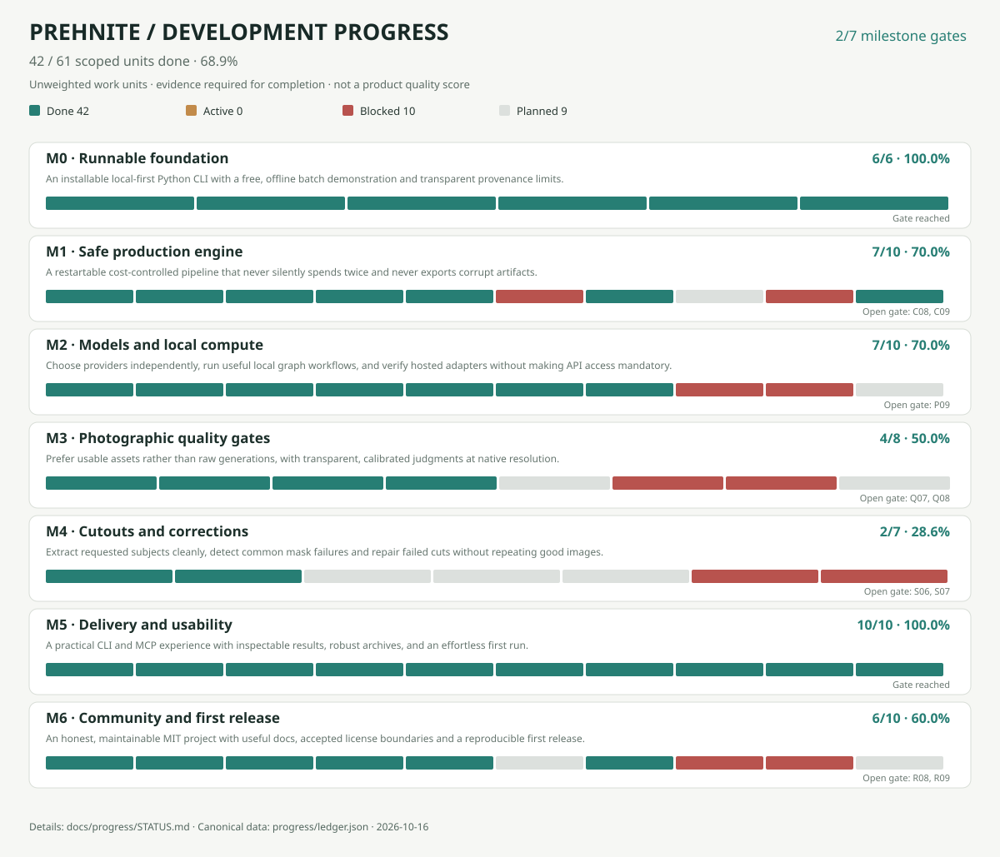

# Prehnite — evidence-based delivery progress

> Generated from `progress/ledger.json` by `scripts/progress.py`. A unit counts only when done with evidence; percentages are not estimates of engineering time or visual quality.

**28 / 61 units done (45.9%)** · 0 active · 10 blocked · 23 planned.
**Milestone gates reached:** 1 / 7.

## Milestone roadmap

| Milestone | Done | Active | Blocked | Planned | Gate |
| --- | ---: | ---: | ---: | ---: | --- |
| M0 · Runnable foundation | 6/6 (100.0%) | 0 | 0 | 0 | Reached |
| M1 · Safe production engine | 5/10 (50.0%) | 0 | 2 | 3 | Open: C08, C09 |
| M2 · Models and local compute | 7/10 (70.0%) | 0 | 2 | 1 | Open: P09 |
| M3 · Photographic quality gates | 1/8 (12.5%) | 0 | 2 | 5 | Open: Q07, Q08 |
| M4 · Cutouts and corrections | 2/7 (28.6%) | 0 | 2 | 3 | Open: S06, S07 |
| M5 · Delivery and usability | 2/10 (20.0%) | 0 | 0 | 8 | Open: D09, D10 |
| M6 · Community and first release | 5/10 (50.0%) | 0 | 2 | 3 | Open: R08, R09 |

## Work units

### M0 · Runnable foundation

| ID | Work package | State | Lane | Depends on | Issue/evidence |
| --- | --- | --- | --- | --- | --- |
| `F01` | MIT repository and installable Python package | done | Agent cloud | — | [Evidence](https://github.com/interzettel/prehnite/pull/1) |
| `F02` | Strict manifest/output path validation | done | Agent cloud | F01 | [Evidence](https://github.com/interzettel/prehnite/pull/1) |
| `F03` | Free synthetic batch generator and 2-tier orchestration | done | Agent cloud | F02 | [Evidence](https://github.com/interzettel/prehnite/pull/1) |
| `F04` | SQLite stage journal and basic resume | done | Agent cloud | F03 | [Evidence](https://github.com/interzettel/prehnite/pull/1) |
| `F05` | JSON/CSV/HTML reports and checked ZIP export | done | Agent cloud | F03 | [Evidence](https://github.com/interzettel/prehnite/pull/1) |
| `F06` | Offline pytest + CLI validation on GitHub Actions | done | Agent cloud | F05 | [Evidence](https://github.com/interzettel/prehnite/pull/1) |

### M1 · Safe production engine

| ID | Work package | State | Lane | Depends on | Issue/evidence |
| --- | --- | --- | --- | --- | --- |
| `C01` | Paid call budget authorization gate | done | Agent cloud | F04 | [Evidence](https://github.com/interzettel/prehnite/pull/10) |
| `C02` | Fail-closed uncertain request recovery | done | Agent cloud | F04 | [Evidence](https://github.com/interzettel/prehnite/pull/10) |
| `C03` | Single-batch worker lock (offline test) | done | Agent cloud | F04 | [Evidence](https://github.com/interzettel/prehnite/pull/10) |
| `C04` | Cross-process kill-and-restart fault matrix | done | Agent cloud | C02 | [Evidence](https://github.com/interzettel/prehnite/pull/49) |
| `C05` | Atomic output writes and checksum replay checks | done | Agent cloud | C02 | [Evidence](https://github.com/interzettel/prehnite/pull/52) |
| `C06` | Versioned pricing quotes and bill reconciliation | blocked | Owner | C01 | [#17](https://github.com/interzettel/prehnite/issues/17) |
| `C07` | Content-addressed, privacy-scoped stage cache | planned | Agent cloud | C05 | [#18](https://github.com/interzettel/prehnite/issues/18) |
| `C08` | Resumable cross-platform interrupted 90-item batch | planned | Agent local | C04, C05 | [#15](https://github.com/interzettel/prehnite/issues/15) |
| `C09` | Actual provider charges reconciled to reserves | blocked | Owner | C06 | [#17](https://github.com/interzettel/prehnite/issues/17) |
| `C10` | Machine-readable stage-level failure taxonomy | planned | Agent cloud | C04 | [#15](https://github.com/interzettel/prehnite/issues/15) |

### M2 · Models and local compute

| ID | Work package | State | Lane | Depends on | Issue/evidence |
| --- | --- | --- | --- | --- | --- |
| `P01` | Demo and optional hosted provider adapter scaffold | done | Agent cloud | F03 | [Evidence](https://github.com/interzettel/prehnite/pull/1) |
| `P02` | Generic local ComfyUI graph/queue scaffold | done | Agent cloud | F03 | [Evidence](https://github.com/interzettel/prehnite/pull/1) |
| `P03` | Offline FLUX tier/upscale contract fixtures | done | Agent cloud | P01 | [Evidence](https://github.com/interzettel/prehnite/pull/50) |
| `P04` | SAM response-shape fixtures and validation | done | Agent cloud | P01 | [Evidence](https://github.com/interzettel/prehnite/pull/53) |
| `P05` | Typed adapter capabilities and price-estimate provenance | done | Agent cloud | P03 | [Evidence](https://github.com/interzettel/prehnite/pull/55) |
| `P06` | Offline ComfyUI graph mapping and mock queue fixtures | done | Agent cloud | P02 | [Evidence](https://github.com/interzettel/prehnite/pull/57) |
| `P07` | ComfyUI queue/recovery without duplicate submits | done | Agent cloud | P06, C02 | [Evidence](https://github.com/interzettel/prehnite/pull/59) |
| `P08` | 8GB VRAM local model feasibility benchmark | blocked | Agent local | P06 | [#24](https://github.com/interzettel/prehnite/issues/24) |
| `P09` | User-approved end-to-end live inference pilot | blocked | Owner | P03, C09 | [#7](https://github.com/interzettel/prehnite/issues/7) |
| `P10` | Provider-choice plan by cost, hardware and quality | planned | Agent cloud | P05 | [#21](https://github.com/interzettel/prehnite/issues/21) |

### M3 · Photographic quality gates

| ID | Work package | State | Lane | Depends on | Issue/evidence |
| --- | --- | --- | --- | --- | --- |
| `Q01` | Dimension and file-decodability technical checks | done | Agent cloud | F03 | [Evidence](https://github.com/interzettel/prehnite/pull/1) |
| `Q02` | Judge schema + invalid response handling | planned | Agent cloud | Q01 | [#25](https://github.com/interzettel/prehnite/issues/25) |
| `Q03` | Order-bias and independent-rubric A/B tests | planned | Agent cloud | Q02 | [#25](https://github.com/interzettel/prehnite/issues/25) |
| `Q04` | Lossless 4K crop panel comparisons | planned | Agent cloud | Q02 | [#26](https://github.com/interzettel/prehnite/issues/26) |
| `Q05` | Optional local quality judge plugin contract | planned | Agent local | Q02 | [#27](https://github.com/interzettel/prehnite/issues/27) |
| `Q06` | Rights-cleared human-rated reference set | blocked | Owner | Q02 | [#28](https://github.com/interzettel/prehnite/issues/28) |
| `Q07` | Calibration report for accepted/rejected quality | blocked | Owner | Q06, Q03 | [#28](https://github.com/interzettel/prehnite/issues/28) |
| `Q08` | Rejection/repair behavior validated across judges | planned | Agent cloud | Q03, Q04 | [#31](https://github.com/interzettel/prehnite/issues/31) |

### M4 · Cutouts and corrections

| ID | Work package | State | Lane | Depends on | Issue/evidence |
| --- | --- | --- | --- | --- | --- |
| `S01` | Demo mask-to-RGBA conversion and coverage checks | done | Agent cloud | F03 | [Evidence](https://github.com/interzettel/prehnite/pull/1) |
| `S02` | Hosted SAM image/mask dimensional conformance | done | Agent cloud | S01, P04 | [Evidence](https://github.com/interzettel/prehnite/pull/53) |
| `S03` | Foreground matte cleanup and edge decontamination | planned | Agent cloud | S02 | [#29](https://github.com/interzettel/prehnite/issues/29) |
| `S04` | Multiple-instance selection and named outputs | planned | Agent cloud | S02 | [#30](https://github.com/interzettel/prehnite/issues/30) |
| `S05` | Failure classification and bounded targeted repair | planned | Agent cloud | S03, Q02 | [#31](https://github.com/interzettel/prehnite/issues/31) |
| `S06` | Transparent cutout benchmark with alpha metrics | blocked | Owner | S03, S04 | [#32](https://github.com/interzettel/prehnite/issues/32) |
| `S07` | Human-accepted cutout samples across tricky materials | blocked | Owner | S06 | [#32](https://github.com/interzettel/prehnite/issues/32) |

### M5 · Delivery and usability

| ID | Work package | State | Lane | Depends on | Issue/evidence |
| --- | --- | --- | --- | --- | --- |
| `D01` | CLI validation, run, estimate and export commands | done | Agent cloud | F03 | [Evidence](https://github.com/interzettel/prehnite/pull/1) |
| `D02` | Machine-readable JSON/CSV plus basic HTML report | done | Agent cloud | F05 | [Evidence](https://github.com/interzettel/prehnite/pull/1) |
| `D03` | Interactive-free, static results gallery | planned | Agent cloud | D02 | [#33](https://github.com/interzettel/prehnite/issues/33) |
| `D04` | Accepted asset efficiency and latency breakdown | planned | Agent cloud | D02, C06 | [#34](https://github.com/interzettel/prehnite/issues/34) |
| `D05` | Versioned provenance and exact input/output hashes | planned | Agent cloud | C05 | [#35](https://github.com/interzettel/prehnite/issues/35) |
| `D06` | Deterministic ZIP ordering and digest manifest | planned | Agent cloud | D05 | [#36](https://github.com/interzettel/prehnite/issues/36) |
| `D07` | Prehnite init/doctor self-check onboarding | planned | Agent cloud | D01 | [#37](https://github.com/interzettel/prehnite/issues/37) |
| `D08` | Safe MCP pause/cancel/reconnect semantics | planned | Agent cloud | C04 | [#38](https://github.com/interzettel/prehnite/issues/38) |
| `D09` | Clean Windows and Linux installation smoke matrix | planned | Agent local | D07 | [#39](https://github.com/interzettel/prehnite/issues/39) |
| `D10` | 90-asset no-cost CLI/MCP fixture bundle | planned | Agent cloud | D06, D08 | [#41](https://github.com/interzettel/prehnite/issues/41) |

### M6 · Community and first release

| ID | Work package | State | Lane | Depends on | Issue/evidence |
| --- | --- | --- | --- | --- | --- |
| `R01` | Keep a Changelog and canonical PEP 440 version | done | Agent cloud | F01 | [Evidence](https://github.com/interzettel/prehnite/pull/13) |
| `R02` | Issue-driven Kanban, PR/issue templates and WIP limits | done | Agent cloud | F01 | [Evidence](https://github.com/interzettel/prehnite/pull/13) |
| `R03` | Persistent A2A coordination and ownership handoffs | done | Agent cloud | F01 | [Evidence](https://github.com/interzettel/prehnite/issues/9) |
| `R04` | Evidence-ledger, milestone roadmap and SVG chart | done | Agent cloud | R02 | [Evidence](https://github.com/interzettel/prehnite/pull/45) |
| `R05` | Human-first README, badge and original mark | done | Agent cloud | R02 | [Evidence](https://github.com/interzettel/prehnite/pull/45) |
| `R06` | Audit dependencies and model-weight licensing | planned | Agent cloud | R01 | [#40](https://github.com/interzettel/prehnite/issues/40) |
| `R07` | 90-asset offline production dry run | planned | Agent cloud | D10 | [#41](https://github.com/interzettel/prehnite/issues/41) |
| `R08` | 90-asset live pilot and owner quality acceptance | blocked | Owner | R07, S07, P09 | [#42](https://github.com/interzettel/prehnite/issues/42) |
| `R09` | Owner-approved version tag and first release | blocked | Owner | R08, R06 | [#42](https://github.com/interzettel/prehnite/issues/42) |
| `R10` | Native GitHub Projects issue/PR state sync | planned | Agent cloud | R02 | [#44](https://github.com/interzettel/prehnite/issues/44) |

## Counting rule

Each stable unit is independently completable. Progress counts done units only, not active/blocked work or story points. Done requires concrete merged PR, committed tests or owner-accepted evidence. Stage achievement requires every named gate done. Unit counts do not estimate equal engineering effort.

Done requires inspectable linked evidence and completed dependencies; milestone attainment requires every named gate. The separate [technical readiness report](../PROGRESS.md) evaluates release risks. Native [GitHub Project #1](https://github.com/orgs/interzettel/projects/1) tracks workflow, not quality. Agents hand off in [issue #9](https://github.com/interzettel/prehnite/issues/9).
